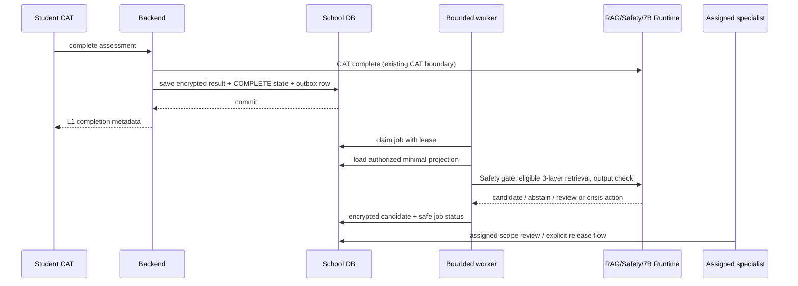

# 测评后教育支持：现状、持久化交付与发布门禁

日期：2026-10-14
范围：只读源码架构调查；本文件是实现分解建议，不是心理内容批准、学校试点许可或 Controller 验收。

## 结论

当前服务已有 school-task CAT、加密作答/结果、Safety、三层 RAG 路由、7B Runtime 接口、独立 AI 对话、任务范围专业复核，以及独立的 L3 反馈草稿/发布门禁。缺失的是“CAT 完成事务与持久化后台教育任务同提交”的 outbox，以及可供自动个人化反馈使用的 L2 专业预批准政策/目录。

因此，可先实现一个只处理合成 task-bound CAT、可恢复、有界并发、不可越过 Safety 的后台管线；在没有精确适用人群、来源、政策版本和 L2 预批准内容前，输出只可作为加密候选、ABSTAIN 或专业复核事项，学生仍只看到 L1 完成信息。独立 AI 对话继续由学生主动发起，可不关联 CAT。

不能把 800 个账号或公开 SAPA 回答当成 800 名真实高中生；SAPA 自选互联网样本不能支持高中人群解释。禁止将原始 CAT 作答、SAPA response rows、未批准分数/参数或未经授权的报告正文发送给普通 RAG/LLM 路径。

## 当前代码事实

| 能力 | 现有行为 | 关键边界 |
|---|---|---|
| School CAT 完成 | `POST /api/v1/assessments/{assessment_id}/complete` 调用 CAT `complete`，再保存 completed assessment；school 路径在 Backend transaction 中重新核验 student、school、enrollment、task 和 CAT binding。 | CAT 外部调用先于本地最终保存；没有与 completed 结果同事务创建的 post-assessment job。HTTP 幂等回执不等于可恢复工作队列。见 `09_backend/src/smhai_backend/domains/assessment/router.py`、`domains/assessment/service.py`、`adapters/database.py:2407`。 |
| 作答和结果加密 | 每个 response 和 assessment result 分别 Fernet 加密，记录 cipher format、key version、payload schema；result 和 completed 状态由 assessment persistence unit of work 保存。 | 加密解决 at-rest 内容保护，不会自动提供队列、租约、重试、发布门禁或最小化生成输入。见 `11_database/database_layer/repositories.py:1350`、`domains/assessment/service.py`。 |
| L1 / L2 / L3 | 学生 CAT history 是完成/任务元数据 L1。`SCHOOL_FEEDBACK_PUBLICATION.md` 明确 L2 catalogue 不存在并应拒绝 L2；当前 `school_feedback` 只允许 L3。 | `school_feedback` 的 L3 `APPROVED`/`PUBLISHED` 是合成工作流状态，不证明心理测量有效性、真实适用性或专业内容已获批准。 |
| Task 专业复核 | `school_professional_reviews` 使用当前任务分配、task/enrollment/assessment scope、加密 case note 和版本化决策；状态含 `OPEN/IN_REVIEW/APPROVED/REJECTED`，case 的 publication_status 固定 `NOT_PUBLISHED`。 | 审核决定与报告发布分离；现有 case 由专业人员工作流管理，不会因 CAT 完成或模型输出而自动获批。 |
| L3 反馈 | Specialist 创建独立加密 DRAFT；只有当前被分配的 specialist 在 case `APPROVED` 且版本匹配时，才能对精确草稿执行显式发布；学生只读 `PUBLISHED`。撤回保留记录。 | 不把专业 review note 复制为学生反馈；反馈与 case note 分离；L3 不能充当自动 L2。 |
| AI/RAG/Safety | 现有普通 Backend orchestration 有 input Safety、D3 边界、RAG、retrieval Safety、LLM、output Safety、引用及 claim 验证；独立 student conversation 明确 assessment-free，先 input Safety，再 RAG/retrieval Safety/LLM/output Safety。 | 独立对话不是 CAT 完成 worker；不得为了复用 UI/API 把原始答案或未发布报告自动塞入会话。Safety/Crisis 需 fail closed。 |
| 持久化生成记录 | `support_runs` 记录 `REQUESTED/COMPLETED/BLOCKED/FAILED`、生成/检索引用和耗时。 | 这是现有同步 support workflow 的记录，不含 worker claim lease、过期认领、重启扫描或 next-attempt 计划，不是 outbox。 |
| RAG 三层 | RAG 技术设计将既有 category 映射为 `policy`、`theory`、`intervention`，可按层和元数据过滤，保留引用/来源。 | 有三层路由实现不代表当前每层都有对目标人群合格、许可明确且通过专业审核的内容。无 eligible evidence 必须 abstain。 |
| 本地模型状态 | 先前正常对话因 generation 输出上限 256 导致 INVALID_STRUCTURED_OUTPUT；Root 将上限修为 768 后，G public normal API 通过三条 citation、input/retrieval/output Safety、Claim Boundary、single attempt、持久化/replay 与权限负测；crisis API 另有 PASS。 | normal API 使用 isolated synthetic RAG；这些结果仍不证明真实来源三层 RAG 或 800 post-assessment jobs 的处理、吞吐、重启恢复或学生反馈发布。 |

## 最小目标设计

后台只消费已提交的 task-bound completed event。创建 outbox row 必须在完成结果加密保存的同一 SQL transaction 中完成；模型、RAG、Safety 等网络调用绝不放入该 transaction。

### Outbox row and idempotency

新增 task-scoped `school_post_assessment_jobs`（建议 revision `20261014_0011`，需 Controller 复核名称/版本）。至少包含：

- opaque `job_ref`; `school_id`, `task_id`, `enrollment_id`, `assessment_session_id`, `subject_id` 的受约束关联；`job_kind`；固定 `eligibility_policy_id/version/hash` 或 `NO_POLICY`；创建/更新时间。
- 状态：`PENDING`, `LEASED`, `RETRY_WAIT`, `CANDIDATE_HELD`, `ABSTAINED`, `REVIEW_REQUIRED`, `CRISIS_HALTED`, `FAILED_TERMINAL`, `CANCELLED`。只有 job 没有 L2 policy、task 被撤销或安全 gate 失败等时，使用明确终态/阻塞码，不能无限重试。
- `attempt_count`, `next_attempt_at`, `lease_owner`, `lease_expires_at`, `last_safe_error_code`, `started_at`, `completed_at`; 可选 generation/retrieval/source manifest 版本引用和耗时。
- 唯一键 `(school_id, assessment_session_id, job_kind, eligibility_policy_version)`。同一次完成/replay 不得创建第二项；敏感 response 或输出正文不进 outbox row。

Claim 使用短事务、锁定可用 PENDING/到期 LEASED 行并更新租约；事务结束后才读取最小允许输入、再做网络调用。租约过期允许其他 worker 恢复。完成/失败更新再用短事务，校验 `job_ref + lease_owner + lease expiry`，防止旧 worker 覆盖新 owner。

语义是 at-least-once delivery + 幂等落库，不承诺模型 HTTP 调用 exactly-once。相同 job 的落库 unique key 和确定 generation identity 可以防重复发布；外部请求若在响应丢失后状态不明，应标 `UNKNOWN_OUTCOME`/人工检查或只按经过验证的 Runtime 幂等协议重试，禁止静默切换模型/云端或无限重生成。

### 内容与状态门禁

- **L1**：完成状态与非敏感任务 metadata 立即可见。没有合格 L2 policy 时 outbox 不调用模型或立即以 `NO_APPROVED_L2_POLICY` abstain；L1 仍可用。
- **L2**：未来仅在独立版本化的人类预批准 catalogue/policy 覆盖精确 population、适用条件、可输入字段、RAG source revisions、声明范围、Safety 条件、UI 文案、发布/撤回规则后启用。后端根据 server-owned policy 构造 allowlist；不接受客户端提交的 score、level、prompt 或“已批准”标记。未命中 policy 不回退到 guessed interpretation。
- **L3 / 特殊复核**：任一 Safety `REVIEW_REQUIRED`、不一致 binding、候选 claim/citation 失败、输出审核失败或需要个案判断，保存为不对学生可见的加密候选/metadata 状态，并进入当前任务分配 specialist worklist。现有 L3 case `APPROVED` 后仍须由 specialist 对精确 L3 草稿执行显式 publish；不能把 job 自动转成 PUBLISHED。
- **Crisis**：如果现有 Safety 明确返回 `CRISIS_ROUTE`，立刻终止普通 retrieval/LLM 路径，使用 Safety 已批准的 crisis response/交接，并保存 content-free action/trace metadata。不得从 SAPA 量表项、通用人格/心理分数、成人样本或自造阈值推断危机。
- **候选内容**：如需要保留，放入单独 versioned candidate 表，正文与 citations 使用现有应用 Fernet provider 加密；学生接口只投影经精确 L2 gate 显式发布的版本。不要扩用 L3 `school_feedback_records` 当通用候选表（它固定 L3，含 review-case FK 和显式人工发布语义）。

### Worker 运行与失败恢复

- 初版可由 Backend lifespan 托管一个 supervised worker loop；启动时扫描待处理/租约过期 jobs，关闭时停止领取并给当前 lease 留出恢复期限。记录 worker heartbeat/owner；未运行/依赖未就绪时，job 留在队列，health/admin 只显示 aggregate counts，不显示心理正文。
- 本地 RTX 3060 的并发默认受配置限制为 1（或小于经实测阈值）；批大小、单次输入输出 token、RAG top-k、deadline 和 GPU concurrency 都受配置上限控制。800 总量不表示 800 并发。
- transient DNS/connect/503/timeouts：有限 exponential backoff + jitter 和最大 attempts；429 尊重 bounded Retry-After。Schema/hash/authorization/source rights/policy mismatch、invalid citations、Safety block 属 terminal 或 human review，不能相同内容循环重试。网络超时结果未知时不自动假定生成失败。
- worker 只记阶段码、错误码、attempt/耗时、component/version refs、safe trace IDs 和 aggregate metrics。禁止 log Prompt、原始 response、解密分数、完整 candidate、password 或 seed data。
- 每次实际发布都重新查询当前 school/SELF/task/enrollment/assignment/policy、候选版本与 release gate。身份/roster/task 撤销、source/policy 撤销、case version 变化立即阻断旧 job 发布；保留审计/撤回证据。

## 实施分解（建议给 Root 的有序任务）

1. **T0 冻结产品/专业前置条件**：不打开 L2 自动发布；列出未来需由人确认的 population、获准来源与版权状态、个性化输入 schema、禁止声明、专业审核者、撤回规则。当前 800 目标先作 synthetic engineering workload，公开 SAPA 只保留独立 research index，不入 school account/profile/outbox。
2. **T1 只加 outbox schema**：新增 SQLAlchemy job model、同 revision Alembic migration 和 snapshot/restore manifest revision `0011`；新增唯一键/tenant/composite FK/check constraints/index；旧 `0010` 表和行零改写。补 model/schema/migration/restore 排序与 downgrade-with-business-data-refusal tests。
3. **T2 完成事务原子化**：在 `MySqlBackendAdapter.school_save_assessment_for_actor` 的既有 UOW 内，当并且仅当 server-validated task assessment 从未完成转成 completed 时，写入唯一 job；测试 completed/result ciphertext/job 原子 commit、事务注入失败全回滚、duplicate completion/replay 只生成一个 job、standalone assessment 不入此队列、revoked/mismatched enrollment 不入队。CAT HTTP 调用仍在 UOW 外。
4. **T3 claim/worker**：增加 repository claim/lease/complete/retry/cancel API、bounded worker config/lifespan 与 restart scanning。用 fake-clock/并发 session 测双 claim、过期 lease 回收、shutdown/restart、bounded attempts、unknown outcome、进程崩溃和不泄露正文。没有 L2 policy 时不连接 Runtime；已过门禁才可调用既有 RAG + Safety + school 7B Runtime。
5. **T4 明确隔离 candidate/release**：只加 encrypted held candidate 与 specialist metadata worklist。先验证 Content Safety、evidence eligibility/rights/version、claim/citation binding；任一缺失 `ABSTAIN`/`REVIEW_REQUIRED`。学生读 API 对 held/review/crisis/abstained/failed rows 统一不可读；另做三校/身份/role/case/task 授权测试。L2 人类预批准目录、内容审查与发布 UI 是后续单独任务。
6. **T5 800 验证**：先用虚构身份、approved synthetic CAT config 或独立模拟输入做 800 job 元数据/加密/恢复压力场景；不使用公开 response rows 冒充真实学生结果、不做临床/人群效度结论。验证 800 queued/reconciled、不同 worker 数、真实 7B 单并发耗时与内存、持久化和审计；Root 再执行完整 Browser/Backend/DB QA。

### 最小文件范围（实施任务按责任拆分）

- Schema：`11_database/database_layer/models.py`；新增 `11_database/migrations/versions/20261014_0011_school_post_assessment_jobs.py`；`13_deployment/school_schema.py`、`school_restore_plan.py` 及相关 trusted/restore manifest/tests。
- Transaction/queue：`11_database/database_layer/repositories.py`、`unit_of_work.py`，`09_backend/src/smhai_backend/adapters/database.py` 中 `school_save_assessment_for_actor` 附近。
- Job domain：新增 `09_backend/src/smhai_backend/domains/post_assessment/`（schemas/service/worker/ports）；`container.py`、`lifespan.py`、`core/config.py` 仅增加显式 worker config/wiring。
- Content gate：新增 held candidate persistence/service/API；复用当前 `SchoolProfessionalReviewService` 授权与既有 `SchoolFeedbackService` 显式 L3 发布边界，不改 frozen assessment/report/Generation Contract。
- Tests：migration/restore compatibility；UOW atomicity/idempotency；lease/concurrency/restart; cross-tenant/task/revoke/role denial; cipher/plaintext/log scans; normal/zero evidence/Safety block/CRISIS_ROUTE/output rejection/claim/citation; no-L2-policy abstain; bounded 800 fake workload; later fresh native API/DB/browser evidence。

## 代码核对索引

- 800 场景的 durable queue、bounded concurrency、独立 L1/L2/L3、安全/危机、跨角色和恢复验收来自 `14_docs/autonomous-delivery/EMPIRICAL_SCHOOL_SIMULATION.md:1-67`；这是工程 acceptance scope，不是专业批准。

- Completion route/idempotency：`09_backend/src/smhai_backend/domains/assessment/router.py:204-251`; completion/CAT call/save order: `domains/assessment/service.py:282-329`。
- Task-scoped same-UOW completion/result storage and reauthorization: `09_backend/src/smhai_backend/adapters/database.py:2328-2405,2407-2498`。
- Encrypted response/result persistence: `11_database/database_layer/repositories.py:1354-1408`; Fernet format/versioned payload: `database_layer/crypto.py:285-346`。
- Durable app idempotency/history models exist, but no post-assessment lease queue: `11_database/database_layer/models.py:800-839` (`SupportRun`), `1615+` (`IdempotencyRecord`). Current schema is `13_deployment/school_schema.py:7-9`, `20261013_0010`.
- Professional case is workflow-only/not-published: `14_docs/autonomous-delivery/SCHOOL_PROFESSIONAL_REVIEW.md`; DTO `domains/professional_reviews/schemas.py:44-55`; model `11_database/database_layer/models.py:1015+`.
- L3-only feedback + absent L2 catalogue and explicit publish: `14_docs/autonomous-delivery/SCHOOL_FEEDBACK_PUBLICATION.md`; `domains/school_feedback/schemas.py:48-94`; `school_feedback/service.py:148-240`; `adapters/school_feedback.py:344-510`。
- Assessment-free independent student chat and APIs: `domains/conversations/schemas.py:1-19`, `router.py:20-108`; input Safety/crisis/retrieval/generation/output Safety: `domains/conversations/service.py:183-256,405-546`。
- Existing synchronous assessment-bound Support/report path: `domains/support/router.py:140-235,247-303`; its Safety/D3/RAG/runtime orchestration is `domains/support/service.py`.
- Three RAG layers and category mapping: `05_rag-engine/RAG_TECHNICAL_DECISION_V1.md:30-38,135+`。Normal G API PASS evidence: `14_docs/autonomous-delivery/CURRENT_STATE.md:129-138`, artifact `G\logs\independent-public-api-d054d89cde604e1bb5359098b6c61637.json`; crisis API PASS: same state `:168-169`, artifact `G\logs\independent-public-api-55829f52843448a4bfeb7d7503198ac1.json`. The older 503 at `:170-172` predates the 256-to-768 correction. Neither evidence proves a real-source three-layer corpus, 800-job queue/run, bounded throughput or restart/publication acceptance.

## Gate for enabling student-visible post-assessment output

Do not turn the worker from candidate/abstain into automatic student-visible L2 until all of the following exist and are independently reviewed: exact population-qualified assessment interpretation policy; approved L2 catalogue/content and version; allowed minimal input projection with no raw responses; eligible rights-cleared RAG sources per layer; validated 7B+RAG+Safety grounded path; reviewed publication/revocation policy; role-scoped student API and browser tests; crisis/review end-to-end tests; encrypted restore/restart and 800-job reconciliation evidence. Controller decides engineering completion; qualified humans decide psychological content/population approval. No implementation status may be called `PSYCHOMETRIC_VALIDATED`, `REAL_PILOT_APPROVED`, or `SCHOOL_PRODUCTION_APPROVED`.
