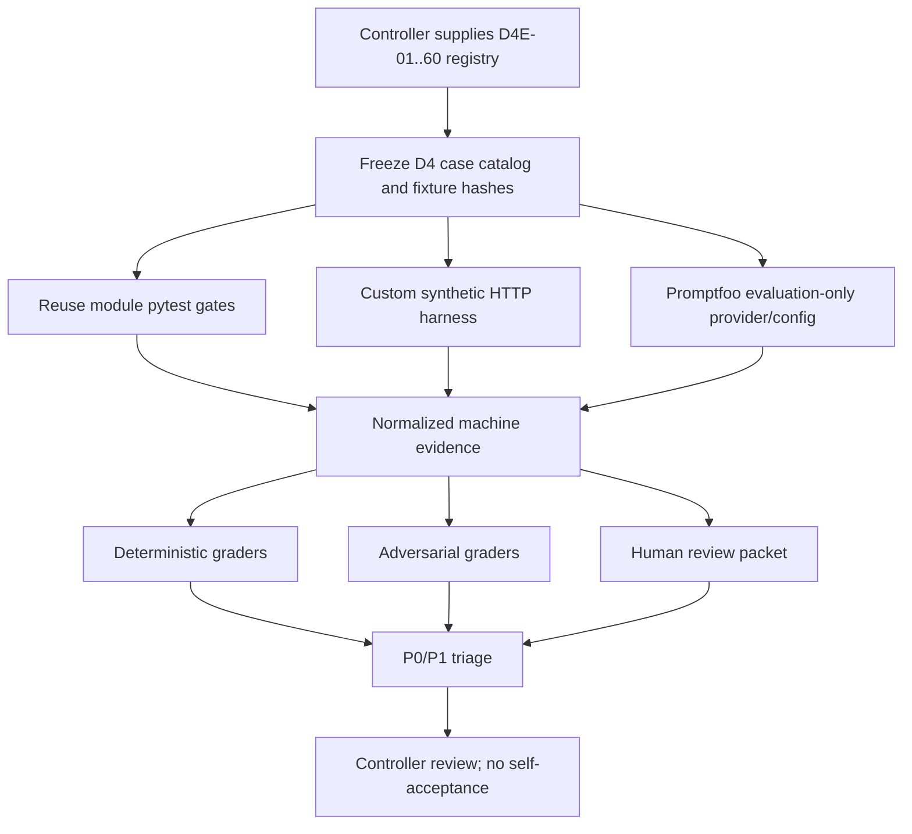

# D4 Phase 0 — Evaluation Recon

**Status:** `D4_RECON_READY_FOR_CONTROLLER_REVIEW`
**Scope:** read-only repository and evidence reconstruction; no D4 implementation
**Baseline fact-layer commit:** `9d9b53b0ac65ffc1013f1d2dffae96ffe0dbf760`
**Published D3 acceptance tag:** `d3-slice4-r1-accepted` → `80140de6fbb63d3239ecc425f9c3daaaf34fb4d7`
**Checkout:** `exp/d3-backend-integration-v1` in `D:\Projects\StudentMentalHealthAI-d3-backend-integration`

This document records what is already reusable for D4, what is still missing, and the proposed evaluation graph. It is not a D4 test implementation, a product acceptance decision, or psychology, legal, consent, pilot, clinical, or production approval.

## 1. Controller boundary and execution record

The Phase 0 instruction was followed as a read-only reconnaissance task. Three workers were dispatched, each with `gpt-5.6-luna / max` and no file-editing or installation authority:

| Worker | Assigned question | Required output |
|---|---|---|
| A — Existing Evaluation Inventory | Inventory reusable tests, evidence, harnesses, duplication, and gaps | Repository evidence map |
| B — Promptfoo Integration Mapper | Map the canonical HTTP target, synthetic session setup, local provider options, extraction, and evaluation-only boundary | Promptfoo integration design |
| C — D4 Risk/Test Matrix Mapper | Map D4E-01..60 against existing and new coverage | Risk/test classification |

The worker reports are advisory inputs. Repository files, accepted evidence, frozen contracts, and this Controller record remain the source of truth.

## 2. Baseline truth

The checkout was inspected before writing this document:

| Check | Result |
|---|---|
| Current branch | `exp/d3-backend-integration-v1` |
| Current `HEAD` | `9d9b53b0ac65ffc1013f1d2dffae96ffe0dbf760` |
| `HEAD` subject | `docs(controller): publish accepted D3 engineering state` |
| Worktree | clean at the time of reconnaissance |
| D3 Slice 4 tag target | `git rev-parse d3-slice4-r1-accepted^{}` = `80140de6fbb63d3239ecc425f9c3daaaf34fb4d7` |
| Product baseline used by D3-4 evidence | tested integration commit `b1a99326885be0fd93adbf8a46db8c14740bef63` |
| D4 branch/tag | none found in the checkout |
| Product changes in this Phase 0 task | none |

The D3 overall state remains `ENGINEERING_COMPLETE / SYNTHETIC_DEMO_SCOPE`. Real-student use and real-pilot authorization remain blocked. A D4 recon does not widen that boundary.

## 3. Evidence inventory

### 3.1 Evaluation contract and root wrappers

`12_evaluation/TASK.md` defines the evaluation layer as synthetic-case, boundary-case, and high-risk-case validation across CAT, RAG, generation, and Safety. It requires `test_case_id`, `fixture_version`, `component_version`, reproducible records, and explicit data/environment/limitation statements. It also forbids presenting synthetic data as a real pilot or mixing technical metrics with research effects.

The root wrapper `00_architecture/tests/run_contract_checks.ps1` is the reusable frozen-contract gate. It runs the root contract test suite and validates `00_architecture/openapi.v1.json` with the OpenAPI validator. It is a prerequisite gate, not a replacement for D4 behavioral evaluation.

### 3.2 Backend integration and canonical routes

Reusable files:

* `09_backend/tests/conftest.py` — in-process ASGI fixture, `BackendSettings(environment="test")`, `httpx.ASGITransport`, synthetic login and assessment helpers.
* `09_backend/tests/test_d3_backend_integration.py` — canonical D3 chain, safety short-circuits, IDOR/forged-field rejection, output-safety persistence boundary, retrieval boundary, role projection, idempotency, and side-effect failure tests.
* `09_backend/tests/test_backend_round1.py` — authentication, CSRF, invalid-session behavior, vertical slice, BOLA/BOPLA/BFLA, rate/idempotency, Safety-down fail-closed behavior, and HTTP error mapping.
* `09_backend/tests/test_d3_chain.py` — trusted D3 composition, one-use interpretation, role policy, admin boundary, and plain-context rejection.
* `09_backend/tests/test_d3_trust_context.py` — server-derived context, caller privilege forgery, IDOR, parent policy boundary, assessment binding, legacy fixture compatibility, mutation detection, and stage-ledger order.
* `09_backend/tests/test_retrieval_evidence.py` — exact observed provenance, immutable bundle, eligibility, citation membership/cross-retrieval rejection, and same-bundle TOCTOU behavior.
* `09_backend/tests/test_contract_api_hardening.py` — typed API success/error envelopes, no input echo, provenance preservation, and generated OpenAPI candidate checks.
* `09_backend/tests/test_structured_output_product_compat.py` — the accepted output-truncation regression and exact-provenance budget check.
* `09_backend/scripts/run_vertical_slice.py` — canonical synthetic in-process path: login → assessment → normal support → crisis → reviewer workflow.
* `09_backend/scripts/run_real_safety_integration.py` — synthetic HTTP composition with a real local Safety service and explicit zero-downstream-call crisis check.

The product-facing evaluation target is `POST /api/v1/support/requests`. The normal path is authenticated, assessment-bound, input-Safety checked, D3-2 interpreted, RAG-retrieved, evidence-bound, role-projected, prompt-assembled, locally generated, output-Safety checked, and persisted. `POST /api/v1/generations` is a direct-generation boundary used for negative trust/IDOR tests; it must not become the public Promptfoo target. `POST /api/v1/retrievals` is a retrieval/evidence boundary and does not invoke the LLM.

The current synthetic session sequence is exact and reusable:

1. `POST /api/v1/auth/login` with `student_a / synthetic-student-a`, `student_b / synthetic-student-b`, `teacher / synthetic-teacher`, or `reviewer / synthetic-reviewer`.
2. Read `data.csrf_token`; send it as `X-CSRF-Token` on mutating routes.
3. Create an assessment using `instrument.synthetic`, version `1.0`, and a synthetic subject.
4. Submit `ITEM_synthetic_1` and complete the assessment.
5. Post a synthetic message to `/api/v1/support/requests` with the assessment ID, target role, and language `zh-CN`.
6. Capture the response envelope, trace ID, stage ledger, call counts, citations, role projection, and persistence outcome.

### 3.3 RAG assets

Reusable RAG tests and helpers are under `05_rag-engine/tests` and `05_rag-engine/src/rag_engine/evaluation`:

* unit coverage for corpus loading, structured query context, identifier-token rejection, metadata intersection/review gates, context/citation ordering, source-bound truncation, index stability, stale-row removal, service trace/citations, rejected-row filtering, RRF score preservation, and negative-query metrics;
* integration coverage for BM25S, Chroma, Qdrant local vectors, API envelope validation, and reranker/dense/hybrid paths;
* `05_rag-engine/evaluation/golden_queries.jsonl` and `05_rag-engine/src/rag_engine/evaluation/harness.py` are candidate inputs for a D4 retrieval-quality group, subject to fixture versioning and no D2 intake promotion.

The accepted D3-4 fixture `12_evaluation/d3-slice4-backend-integration-r1/fixtures/university_freshmen_synthetic_validation_corpus.jsonl` is reusable only as controlled synthetic validation data. `rag_ineligible_validation_corpus.jsonl` and the output-unsafe fixture are negative-boundary assets. The unreviewed D2 intake remains ineligible for product generation or D4 acceptance evidence.

### 3.4 Safety assets

Reusable Safety tests and harnesses are under `08_safety-engine/tests` and `08_safety-engine/evaluation/harness.py`:

* unit tests for normal allow, PII redaction, prompt-injection blocking, crisis routing, OPA-down fail-closed behavior, unexpected policy/health failures, guard-down behavior, crisis precedence, and auditable review workflow;
* internal schema and root-contract checks;
* integration/e2e tests for Presidio, NeMo Guardrails, OPA, and the local HTTP service;
* the accepted D3-4 Safety evidence covers normal, crisis, Safety-down, output-Safety, and persistence boundaries.

The D4 layer should compose these decisions and inspect their side effects. It should not copy the Safety rules into a second evaluator.

### 3.5 LLM Runtime assets

Reusable Runtime tests and evidence are under `06_llm-runtime/tests` and `06_llm-runtime/reports`:

* frozen generation boundary and schema semantics;
* Ollama provider request format, NDJSON normalization, chat-message containment, discovery metadata, and error mapping;
* runtime state-machine transition rejection, loopback-provider policy, owned-process lifecycle, invalid structured output, fallback exhaustion, bounded concurrency, cancellation, trace logging, and buffered generation;
* opt-in local Ollama integration in `06_llm-runtime/tests/integration/test_ollama_integration.py`;
* runtime reconstruction and structured-output compatibility evidence under `12_evaluation/runtime-reconstruction-r1` and `12_evaluation/structured-output-compat-r1`.

D4 may reuse the Runtime checks as a provider/robustness group. It must not silently turn the optional GPU/Ollama checks into a mandatory product acceptance gate, and must retain the known fixed-output-budget and historical GPU snapshot P1 boundaries.

### 3.6 Accepted D1/D2/D3 assets

The accepted engineering inputs are recorded in `14_docs/project-controller/ACCEPTANCE_INDEX.md`, `DEPENDENCY_MATRIX.md`, and the D3 decision/evidence records. The corresponding D3 evaluation records are:

| Slice | Evidence asset | Observable result |
|---|---|---|
| D3-1 | `12_evaluation/d3-slice1-acceptance-closure/d3_slice1_acceptance_closure.json` | 48/48 module tests, root/OpenAPI/frozen checks, synthetic-only boundary |
| D3-2 | `12_evaluation/d3-slice2-assessment-adapter-r1/d3_slice2_assessment_adapter_evaluation.json` | 41 module tests; decision-fidelity and regression evidence; no P0 |
| D3-3 | `12_evaluation/d3-slice3-role-projection-r1/d3_slice3_role_projection_evaluation.json` | 99 focused, 147 Prompt Engine, 41 D3-2, 48 D3-1, 24 CAT, and 13 root tests passed in the recorded closure |
| D3-4 | `12_evaluation/d3-slice4-backend-integration-r1/d3_slice4_backend_integration_evaluation.json` | recorded Backend/RAG/Safety/D3/root/OpenAPI evidence; no product P0; baseline Pyright and other P1s preserved |
| GPU/Runtime | `12_evaluation/gpu-product-integration-closure-r1` and `12_evaluation/runtime-reconstruction-r1` | reusable machine evidence, local model attribution, crisis zero-call, output safety, persistence, and structured-output compatibility records |

D1 psychology review, psychometric validity, D2 rights/licensing and specialist review, real-student authorization, and production enablement are separate human/governance decisions. D4 can evaluate engineering behavior around those boundaries without converting them into approval.

The full D1/D2 evaluation packages live in sibling worktrees and are not all materialized in this D3 checkout. The read-only inventory located these reusable assets:

* D1: `D:\Projects\StudentMentalHealthAI-psychometrics\12_evaluation\psychometrics-r1\run_project_evaluation.py`, `psychometric_round1_evaluation.json`, `psychometric_round1_closure_evaluation.json`, `application_claim_audit.json`, plus the final closure and human-review packet under `14_docs\psychometrics`.
* D2: `D:\Projects\StudentMentalHealthAI-d2-knowledge-corpus\12_evaluation\knowledge-corpus-r1\provenance_roundtrip_3x3x3.json`, `CORPUS_COVERAGE_QUERY_SET_V1.json`, `knowledge_corpus_round1_closure_evaluation.json`, and the provenance/coverage scripts, plus the rights and human-review records under `14_docs\knowledge-corpus`.

Their recorded scope is engineering/synthetic evidence. D1 does not establish psychometric validity, risk-cutoff validity, fairness, or pilot readiness. D2 does not establish rights for public distribution, specialist approval, or clinical corpus quality. D4 should reference these packages by path and preserve their pending human decisions rather than copy their result numbers into a new acceptance claim.

## 4. Existing coverage, duplication, and gaps

### Strong reusable coverage

* frozen contracts and OpenAPI envelopes;
* session/CSRF and role authorization;
* assessment binding, IDOR, forged authority fields, and trust context;
* D3-1 → D3-2 → D3-3 ordering and prompt provenance;
* exact RAG provenance, bundle identity, citation membership, and TOCTOU;
* input Safety short-circuits with zero RAG/LLM calls;
* output Safety before normal report persistence;
* role-specific coarse projections and admin minimum disclosure;
* idempotency and selected side-effect failure behavior;
* Runtime structured output, provider errors, local fallback, trace, and lifecycle;
* synthetic data and no-real-student boundaries.

The inventory worker also confirmed strong historical coverage in the accepted D3 fidelity records: D3INT `60/60`, D3SEAM `20/20`, D3VAL `16/16`, the D3-4 real HTTP normal/crisis/Safety-down/output-unsafe/no-eligible scenarios, and the module reports for CAT, Knowledge Pipeline, RAG, Safety, Backend, Database, and Runtime. These are reusable regression baselines, not evidence of D4 acceptance.

### Partial coverage that D4 should compose or extend

* repeated multi-turn student/teacher/reviewer flows are represented by helpers and single-turn tests, but there is no dedicated versioned multi-turn matrix;
* Promptfoo is not present in the repository or environment, so integration ownership is designed but not installed or executed;
* evaluator-wide run manifests, result normalization, seed control, and cross-group aggregation are not yet a D4 artifact;
* adversarial prompts, retrieval poisoning, cross-turn identity drift, disclosure escalation, and robust refusal behavior are not covered as a systematic matrix;
* output quality and citation usefulness need a human-review protocol; deterministic schema validity alone is insufficient;
* D4E-01..60 exact row mapping is unavailable (see Section 5).

Other partial areas confirmed by the inventory are the RAG negative-query/abstention boundary, Safety retrieval/streaming and long-tail coverage, fixed output-budget robustness across prompt/context shapes, resource cleanup, and cross-case restart/recovery. The D1 and D2 closure records also explicitly distinguish historical evaluation numbers from what was rerun in the closure; D4 must retain that distinction.

### Duplication to avoid

* do not copy Backend safety, RAG citation, D3 trust, or Runtime state-machine assertions into a second pytest suite;
* do not use Promptfoo to re-implement the trusted backend chain or call Ollama directly for product acceptance;
* do not create another synthetic corpus when the versioned D3-4 validation corpus is sufficient;
* do not add a second JSON repair, schema weakening, or blind retry path to make an evaluation pass;
* do not run the same deterministic case through pytest, a custom harness, and Promptfoo unless the layers test different observables and share a case ID.

## 5. D4E-01..60 registry gap

A repository-wide read-only search covered the current checkout, `12_evaluation`, `14_docs/project-controller`, visible `D:\Projects\StudentMentalHealthAI*` sibling worktrees, Git history, the available `C:\Users\15848\Documents\Codex` cache, and `.codex/attachments` text/json/md files. No authoritative `D4E-01` through `D4E-60` definitions were found. The current fact layer says D4 is pending/not authorized but does not contain the 60-row registry.

All 60 identifiers are therefore individually `UNMAPPABLE / DEFINITION_MISSING` at this Phase 0 boundary. This is a missing-definition result, not a failed test. Therefore this recon does **not** invent a one-to-one D4E mapping. Any matrix produced before the Controller supplies the registry would be a provisional coverage taxonomy, not evidence that D4E rows were satisfied. The exact registry is a Controller input required before D4 implementation and acceptance.

## 6. Promptfoo integration boundary

Promptfoo is not installed and no installation is requested in Phase 0. The proposed future integration is evaluation-only:

* **Target:** the local canonical Backend HTTP surface, preferably `/api/v1/support/requests` through a test-only local server or an ASGI-compatible adapter. The target must retain the product envelope and machine evidence instead of returning only a flattened model string.
* **Setup:** a synthetic login obtains the CSRF token; the evaluator creates or binds a synthetic assessment; each case uses an isolated session and assessment ID; the token and any cookie are carried only for that case.
* **Session facts:** the current test app returns `data.csrf_token` and a `smhai_dev_session` cookie. Every mutating request must carry both. The exact D3 fixture is not automatically preloaded by the normal HTTP app; D3 tests bind it directly in the in-memory repository. An HTTP bootstrap assessment proves lifecycle behavior but is not automatically equivalent to the exact `UNIVERSITY_FRESHMEN_SYNTHETIC_DEMO` fixture.
* **Stateful cases:** use an evaluation-only custom provider or wrapper when a case requires several HTTP calls. Promptfoo's HTTP provider supports templated headers, authentication hooks, session parsing, and session variables; its custom JavaScript/Python provider can orchestrate the multi-step case and return the actual product response plus metadata. See the official [HTTP provider documentation](https://www.promptfoo.dev/docs/providers/http/) and [custom JavaScript provider documentation](https://www.promptfoo.dev/docs/providers/custom-api/).
* **Local provider options:** the primary product target remains the existing local Backend composition. The in-process fake path is useful for deterministic structural checks; local Safety/Runtime/Ollama servers are optional evidence tiers. No cloud provider or fallback may enter a product acceptance run.
* **Output extraction:** parse `response.json()` and preserve `data`, `trace_id`, status, stage ledger, call counts, role projection, citations, safety action, and persistence facts. Assertions may use Promptfoo's JavaScript/Python assertions, but the canonical machine evidence remains the custom harness record. See the official [assertions documentation](https://www.promptfoo.dev/docs/configuration/expected-outputs/).
* **Evaluation-only rule:** no Promptfoo config may modify `09_backend`, `06_llm-runtime`, D3 contracts, OpenAPI, Safety policy, RAG identity, or production settings. A Promptfoo failure is an evaluation result, not a reason to relax product behavior.

The exact auth implementation, response parser, and provider file are intentionally deferred until the D4E registry, Promptfoo version, and Controller's local-provider budget are approved.

### Worker findings retained for review

* Worker A confirmed that root/OpenAPI, D1 psychometric parity, D2 provenance/coverage, D3 slice evidence, GPU closure evidence, structured-output budget evidence, Backend, RAG, Safety, and Runtime harnesses are reusable, while their historical pass counts must not be merged into one new total.
* Worker B confirmed that a custom Promptfoo JavaScript provider is the safer future choice for login → cookie/CSRF → assessment bootstrap → support, while the static HTTP provider is suitable only when session state is already supplied. It also confirmed that Promptfoo must not call Ollama or an internal Runtime route directly.
* Worker C confirmed that D4E-01..60 are `60/60 UNMAPPABLE / DEFINITION_MISSING`, and proposed the deterministic/adversarial/behavioral/human-review taxonomy in the SDD as a provisional implementation plan only.

## 7. Proposed implementation graph

Dependencies are intentionally one-way: fixture and registry decisions precede implementation; product modules remain below the evaluation layer; human review remains separate from automated scores.

## 8. Phase 0 conclusion and Controller inputs

The repository has enough reusable engineering evidence to draft D4 without duplicating D3. The next authorized step should be a reviewed D4 SDD and case-catalog decision, not immediate test implementation.

Controller inputs still required before D4 implementation:

1. authoritative D4E-01..60 registry and severity/ownership definitions;
2. approved Promptfoo version and whether it may run only against the in-process/local HTTP target or also an opt-in local Ollama target;
3. exact synthetic role/population cases for any future parent projection; no real parent/student data;
4. whether model-assisted grading is allowed as a non-authoritative signal, with deterministic and human review remaining authoritative;
5. approval of the proposed `12_evaluation/d4-evaluation-r1/` layout and run-manifest schema.

No D4 tests, Promptfoo installation, Inspect AI, garak, D4 branch, product edit, D3 edit, merge, push, or tag was performed.

## Final SDD Reconciliation

This section records the reconciliation of the original Phase 0 Recon, the historical SDD Draft, the Controller-frozen D4E-01..60 decisions, the D4SUP-01..20 third-party supplement, and the current repository topology. Earlier sections are preserved as reconnaissance history and are not silently rewritten.

### What the original Recon found

The original Recon correctly identified the reusable root, Backend, RAG, Safety, Runtime, and D3 evidence; the canonical product entrypoint `POST /api/v1/support/requests`; synthetic-only and loopback boundaries; the need to keep Promptfoo evaluation-only; and the need to reuse existing deterministic gates before adding new harnesses.

### What became stale

The old statement that D4E-01..60 were definition-missing is superseded by the Controller mission and the materialized technical decision. The historical Draft also understated Promptfoo's D4 R1 role and did not materially cover claim-level support, false refusal, Chinese semantic families, DEV/REGRESSION/SEALED separation, or local Promptfoo privacy/network verification. Those historical conclusions remain visible for provenance only.

### Reconciled authority and artifacts

- `D4_EVALUATION_TECHNICAL_DECISION_V1.md` materializes the exact 60 canonical D4E meanings and 20 D4SUP meanings.
- `D4_EVALUATION_SDD_V1.md` is the single implementation-ready candidate and is `READY_FOR_CONTROLLER_FREEZE`.
- `D4_REQUIREMENT_COVERAGE_MATRIX.md` has one row for every D4E and D4SUP ID and distinguishes reusable evidence from proposed coverage.
- `D4_FINAL_SDD_FIDELITY_REPORT.md` records structural materialization separately from runtime/test acceptance.
- `D4_EVALUATION_SDD_DRAFT.md` is explicitly `HISTORICAL_DRAFT / SUPERSEDED` and points to the final candidate.

The reconciled design adds claim-support labels and human calibration, a deterministic `MUST_ANSWER` set and false-refusal metrics, required Chinese synthetic scenario families without invented clinical thresholds, actual-product-capability multi-turn boundaries, DEV/REGRESSION/SEALED anti-tuning rules, and explicit Promptfoo target/attacker/grader/telemetry/sharing/network controls.

### What remains true

D3 remains `ENGINEERING_COMPLETE / SYNTHETIC_DEMO_SCOPE` with D3-1..4 `FULL PASS / CONTROLLER ACCEPTED`; the accepted tag target and fact-layer baseline are unchanged. Real pilot remains `BLOCKED`. Product modules, Root/OpenAPI/contracts, D3, and dependency state are unchanged. Promptfoo is not installed; no D4 tests or adversarial run has been executed; no D4 branch, merge, push, or tag has been created. The current working tree is expected to be dirty only until this governance/docs commit is made, after which the final verification must confirm cleanliness.

### Final reconciliation status

`READY_FOR_CONTROLLER_FREEZE` for the SDD candidate. This does not authorize D4 implementation or constitute D4 acceptance; the Project Controller must freeze the documents and separately authorize D4-1.
