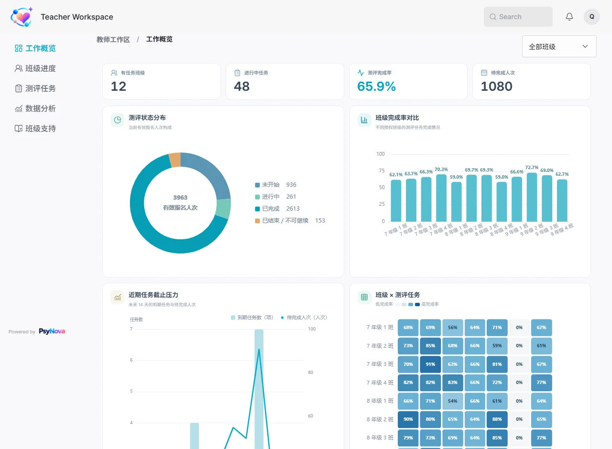
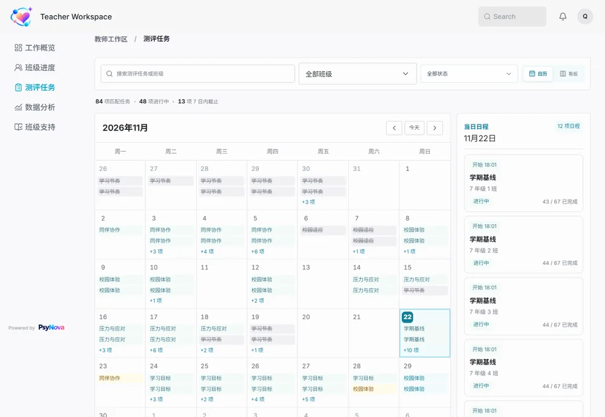
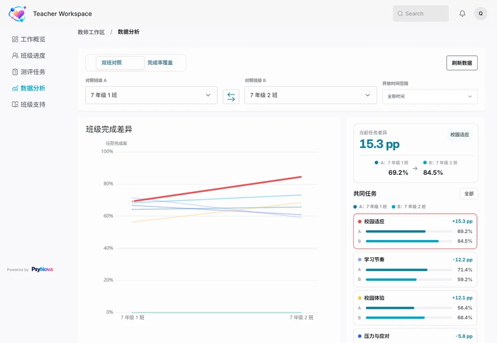

  

# PsyNova 校园心育平台

PsyNova 把学校账号、测评发布、班级进度和专业支持放在同一个平台。学校管理员准备组织和任务，学生完成测评，普通教师跟进授权班级，心理教师处理专业资料、测评方案和复核事项。

[打开线上体验](https://psynova.top/login) · [产品介绍](https://xiajiadi.github.io/StudentMentalHealthAI/) · [查看 2.0 发布](https://github.com/xiajiadi/StudentMentalHealthAI/releases)

## 两种部署方式

| | 线上体验版 | 学校本地版 |
| --- | --- | --- |
| 用途 | 公网注册，走通四角色操作 | 学校独立安装，建立自己的组织和账号 |
| 初始数据 | 每个注册账号获得独立合成学校、样例班级和测评任务 | 从空业务库开始，首次配置学校和管理员 |
| 登录 | 公网体验账号和学校角色选择 | 由学校发放账号或初始凭据 |
| AI 推理 | 当前公网环境使用 DeepSeek，并经安全检查和资料检索 | 采用学校机器上的 Qwen 和本地服务配置，下载及运行条件以安装说明为准 |
| 入口 | [公网登录](https://psynova.top/login) | [发布和安装状态](https://github.com/xiajiadi/StudentMentalHealthAI/releases) |

2.0 的线上界面基线来自已部署的 Vue 发布包。后端、数据库契约和安全服务的现场核对范围见[版本记录](13_deployment/VERSION_2.md)。

## 典型使用流程

1. **建立学校组织**。学校管理员下载名单模板，导入学生和教职工，并按班级分配账号。
2. **准备和发布任务**。心理教师核对专业资料、题库和测评方案。管理员配置测评开放时间和目标班级。
3. **完成测评**。学生从“我的测评”开始或继续作答，查看有效记录和获准发布的反馈。
4. **跟进班级进度**。普通教师在授权班级内查看任务概览、日历、看板以及汇总。心理教师在专业工作区处理复核与支持事项。

| 测评任务日历 | 双班完成率对照 |
| --- | --- |
|  |  |

登录后可从工作区底部打开“使用手册”。线上体验请使用合成数据。普通教师只接收授权班级的进度汇总，学生反馈由相应的发布权限控制。

[学校账号管理截图](site/assets/admin-accounts.webp) · [心理教师 CAT 管理截图](site/assets/specialist-cat.webp) · [学生工作区截图](site/assets/student-workspace.webp)

## 仓库导航

| 要找什么 | 去哪里 |
| --- | --- |
| 产品介绍和截图 | [site](site/) |
| 部署入口、验证和版本差异 | [13_deployment](13_deployment/) · [2.0 版本记录](13_deployment/VERSION_2.md) |
| 用户界面与工作区 | [Vue 前端](10_frontend/) |
| 应用接口、鉴权和数据 | [后端](09_backend/) · [数据库](11_database/) · [接口契约](CONTRACTS.md) |
| 测评、检索、模型与安全 | [CAT](01_cat-engine/) · [RAG](05_rag-engine/) · [模型运行时](06_llm-runtime/) · [安全检查](08_safety-engine/) |
| 架构和维护指引 | [架构](ARCHITECTURE.md) · [模块索引](MODULES.md) |
